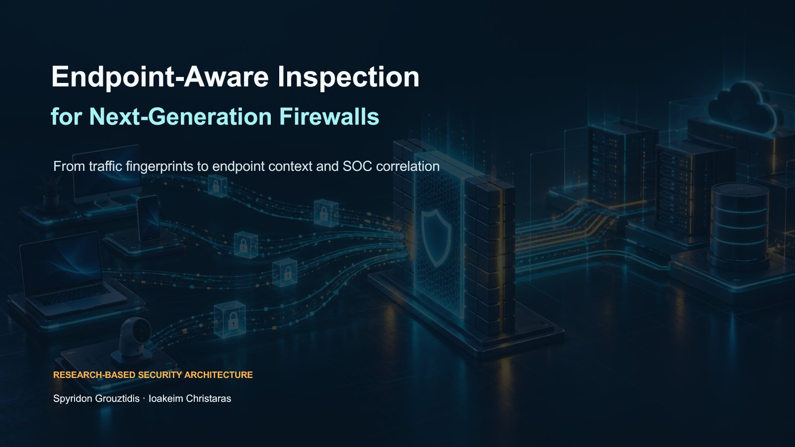
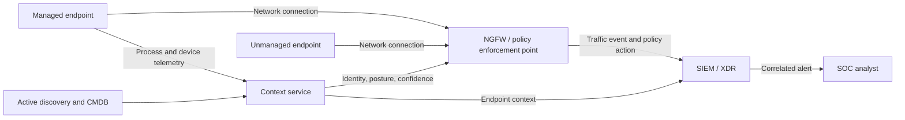

# Endpoint-Aware Inspection for Next-Generation Firewalls

This repository examines how a next-generation firewall (NGFW) can use endpoint context to make more precise security decisions. It compares passive traffic fingerprinting with active discovery and endpoint telemetry, then translates the research into a vendor-neutral architecture and an illustrative SOC correlation use case.

The project builds on the open-access survey by Heino, Hakkala, and Virtanen and connects its findings to the policy enforcement model in NIST SP 800-207. It was redesigned from an academic presentation into an English-language cybersecurity portfolio case study.

## Why endpoint awareness matters

Network traffic can look identical at the firewall while being produced or consumed by different applications. Application identity, device posture, process context, and asset state can help analysts distinguish a benign connection from activity that requires investigation or blocking.

No identification method is sufficient on its own. Passive methods provide broad coverage but can be spoofed or become inaccurate as protocols change. Active methods provide stronger context but require managed endpoints, integrations, or repeated discovery. The practical design is a layered model that combines both sources and records confidence explicitly.

## Repository contents

- [English presentation](presentation/ngfw-endpoint-awareness-en.pptx) — a 12-slide technical briefing for security and SOC audiences.
- [PDF presentation](presentation/ngfw-endpoint-awareness-en.pdf) — a portable version for GitHub review.
- [Method comparison](analysis/method-comparison.md) — strengths, constraints, and operational uses of each identification method.
- [Reference architecture](analysis/reference-architecture.md) — a vendor-neutral endpoint, NGFW, and SIEM integration model.
- [Detection use case](analysis/detection-use-case.md) — an illustrative TLS fingerprint and endpoint-process correlation workflow.
- [Illustrative KQL](detections/ngfw-endpoint-correlation.kql) — a Microsoft Sentinel / Defender-style query that requires local schema adaptation.
- [References](references/references.md) — primary research and authoritative guidance.

## Architecture

## Illustrative detection scenario

1. The NGFW observes an unusual TLS fingerprint or traffic pattern.
2. Endpoint telemetry maps the source connection to a process, signer, device, and user context.
3. The SIEM correlates both signals within a bounded time window.
4. Risk increases when the process is unsigned, the device is unmanaged, or the fingerprint is rare for the environment.
5. The analyst receives the network evidence and endpoint context in one alert.

The included KQL is an architectural example. It has not been validated against a production tenant, vendor connector, or live firewall dataset.

## Evidence boundaries

- This is a research-based architecture and detection design, not a deployed NGFW implementation.
- Product capabilities change and must be verified against current vendor documentation before procurement or deployment.
- Fingerprints such as JA3 or JA3S are signals, not identities. Shared libraries, collisions, evasion, and protocol evolution reduce certainty.
- Endpoint telemetry can improve attribution but introduces collection, privacy, retention, and trust requirements.
- Enforcement should use multiple signals and a documented confidence threshold.

## Authors and contributions

- **Spyridon Grouztidis** — technical synthesis, portfolio redesign, architecture, and detection-engineering interpretation.
- **Ioakeim Christaras** — research synthesis and original academic presentation.

## License

The authors retain all rights to the original analysis, presentation, diagrams, and repository documentation. See [LICENSE.md](LICENSE.md). Referenced third-party works remain subject to their own licenses.
